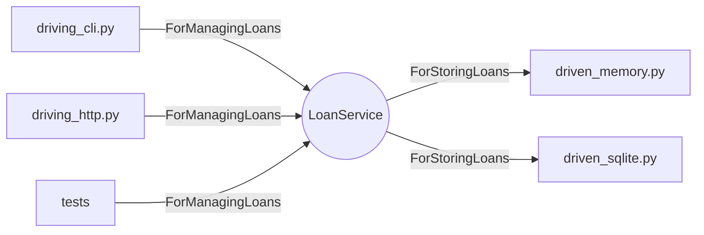

# Hexagonal architecture: ports and adapters — explained

## The intuition
Lesson 2 had layers stacked top to bottom. Hexagonal architecture turns the stack inside out: the business rules (`domain.py`) sit in the middle and define *ports* — interfaces named for what they are for. `ForManagingLoans` is the driving port: HTTP, CLI and tests call it. `ForStoringLoans` is the driven port: the domain calls it, and memory or SQLite adapters implement it. The domain imports `dataclasses` and `ports`, nothing else.

The payoff is symmetry: adding a CLI is the same work as adding SQLite — write an adapter, plug it into a port. The composition root (`app.build`) picks the adapters.

**Analogy:** a laptop's USB-C ports: chargers and screens are adapters; the motherboard does not change.
Where the analogy breaks: USB-C forces compliance; a Python `Protocol` does not stop a half-built adapter being plugged in (try_it [2]).



**The one thing to remember:** the domain owns the interfaces; technology lives only in adapters at the edge.

## Walkthrough: what actually happens when you run it
1. **You run** `python app.py --storage memory`, then `--storage sqlite`.
   **What happens inside:** `build()` creates one `LoanService` over the chosen store and hands the *same* service object to both an HTTP server and the CLI function. The second borrow comes in over HTTP, reaches `LoanService.borrow`, which raises `BookAlreadyOnLoan`; `driving_http` maps it to 409, while the CLI maps `LoanNotFound` to exit code 3.
   **What you see** (identical for both stores):
   ```
   cli  borrow b1 m1      -> 0 {"id": 1, "bookId": "b1", "memberId": "m1", "status": "active"}
   http POST b1 by m2     -> 409 {'error': 'book b1 is already on loan'}
   cli  return 1          -> 0 {"id": 1, "bookId": "b1", "memberId": "m1", "status": "returned"}
   http GET /loans/1      -> 200 {'id': 1, 'bookId': 'b1', 'memberId': 'm1', 'status': 'returned'}
   cli  show 99           -> 3 error: loan 99 not found
   ```
   **What it means:** one domain, two driving adapters, each with its own error language (`EXIT = {LoanNotFound: 3}`, other rule errors 2).

2. **You run** the CLI alone: `python driving_cli.py --db demo.db borrow b1 m1`, again with `m2`, then `return 1`.
   **What you see:** the JSON loan with `exit=0`; `error: book b1 is already on loan` with `exit=2`; then `"status": "returned"`. The SQLite file persists state between three separate processes.

3. **You run** `python -m unittest -v`.
   **What happens inside:** `StoreContract` is one set of tests run against every driven adapter — the port's contract written as tests.
   **What you see:** `Ran 19 tests in 34.901s` … `OK`.

4. **You run** `python try_it.py`.
   **What you see:**
   ```
   [1] domain.py imports sqlite3 -> FAILED (failures=1): domain.py must depend on ports only, but imports ['sqlite3']
   [2] isinstance(HalfStore(), ForStoringLoans) -> False
   [2] borrow b1 -> loan 1 (still works)
   [2] give_back(1) -> AttributeError: 'HalfStore' object has no attribute 'mark_returned'
   ```
   **What it means:** [1] the dependency rule is a test. [2] nothing calls `isinstance` at wiring time, so a store missing `mark_returned` runs until the first return — hence contract tests.

5. **You run** `python -m unittest test_build_task -v` (checks `solution/driven_jsonfile.py`; add `CHECK_MINE=1` for yours).
   **What you see:** `Ran 6 tests in 4.818s` … `OK` — a JSON-file adapter passes the same contract with `domain.py` untouched.

## Common confusions
**Q:** Hexagonal means six of something. — **A:** No; the shape just leaves room for many ports. This lab has two.

**Q:** A `Protocol` stops wrong adapters. — **A:** try_it [2]: `isinstance` returned `False`, yet `borrow` still worked; only tests catch it.

**Q:** Ports should be named after technology (`SqlPort`). — **A:** Name them for the purpose (`ForStoringLoans`), so a file or a cloud store fits the same port.

## Check your understanding
1. Which file is the composition root?
<details><summary>Answer</summary>`app.py` (`build()`), and `driving_cli.py`'s own `__main__` for the stand-alone CLI.</details>

2. Why exit 2 for the conflict but 3 for not-found?
<details><summary>Answer</summary>`EXIT = {LoanNotFound: 3}`; other rule violations default to 2.</details>

3. What makes a new adapter "done"?
<details><summary>Answer</summary>It passes `StoreContract` without any change to `domain.py` — what `test_build_task` checks.</details>
