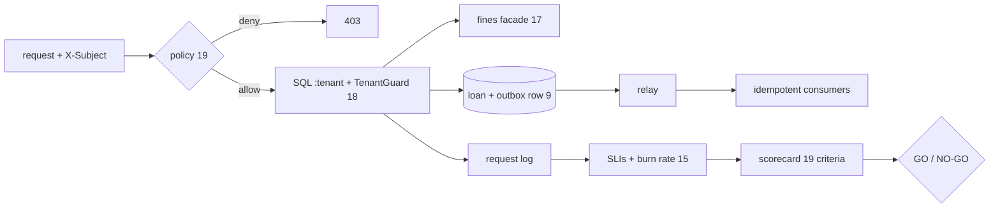

# Capstone: Library Loans, production-ready — explained

## The intuition
The capstone asks whether earlier answers still hold *together*, in one service, before each release: policy first (19), tenant-scoped SQL under `TenantGuard` (18), fines via the strangler facade (17), loan + event in one outbox transaction (9), then SLI, contract, capacity and ADR checks (14, 15, 21). `reuse.py` loads the earlier labs' own modules.

The release decision is a **scorecard**: 19 criteria computed from running code; GO only if all pass. Four seeded faults must each turn it NO-GO, caught by exactly the expected criteria.

**Analogy:** an aircraft's pre-departure check: sign-off only when every line is green.
Where the analogy breaks: this checklist must grow — a new risk needs a new criterion, or the scorecard silently stops covering it.



**The one thing to remember:** a release is a measured verdict over every architectural decision, and the verdict itself is tested by faults it must catch.

## Walkthrough: what actually happens when you run it
1. **You run** `python run_capstone.py; echo exit=$?`.
   **What happens inside:** a seeded workload drives `LoansService`; each criterion reads the result and prints one JSON line.
   **What you see** (3 of 19 lines, then the summary):
   ```
   {"milestone": "M1 strangle", "criterion": "fines parallel run", "measure": "mismatch rate over 2,000 shadow requests", "value": 0.0, "threshold": "<= 0.001", "pass": true}
   {"milestone": "M4 events", "criterion": "outbox completeness", "measure": "committed changes vs outbox rows", "value": "469/469", "threshold": "equal", "pass": true}
   {"milestone": "M5 SLO + CI", "criterion": "capacity N+1", "measure": "p99 ms with one instance down", "value": 130.4, "threshold": "<= 300", "pass": true}
   {"summary": true, "fault": null, "passed": 19, "total": 19, "failed": [], "verdict": "GO"}
   exit=0
   ```
   **What it means:** the evidence files back it up: `out/requests.jsonl` and `out/decisions.jsonl` have 615 lines each — one policy decision per request, `decisions logged 615, with email` 0.

2. **The faults.** `python run_capstone.py --fault <name>` for each:
   ```
   {"summary": true, "fault": "fines-rounding", "passed": 17, "total": 19, "failed": ["fines parallel run", "fines cut over"], "verdict": "NO-GO"}
   {"summary": true, "fault": "cross-tenant-policy", "passed": 16, "total": 19, "failed": ["cross-library reads", "policy requirement cases", "cross-library probes denied"], "verdict": "NO-GO"}
   {"summary": true, "fault": "unscoped-query", "passed": 16, "total": 19, "failed": ["tenant guard", "tenant-scoped SQL", "cross-library reads"], "verdict": "NO-GO"}
   {"summary": true, "fault": "duplicate-delivery", "passed": 18, "total": 19, "failed": ["idempotent consumers"], "verdict": "NO-GO"}
   ```
   `unscoped-query` exits 1 and its failing lines show `"value": 135` statements without the tenant id and `"value": 20` foreign rows. **What it means:** defence in depth is visible. The unscoped query is caught three ways (runtime guard, static gate, probe). The cross-tenant policy fault slips past the tenant layer's static checks but is caught by the policy tests *and* by real cross-library reads (5 rows). The fines fault from lesson 17 keeps the facade in `shadow`, so the cut-over criterion fails as well.

3. **Why the ADRs chose this shape.** ADR 0006: one modular service with *one* extracted module, not a fleet of microservices. ADR 0007: layered guards, policy then tenant. ADR 0008: outbox events and async email (the capacity result from lesson 21). ADR 0009: release gates decide, the agent only explains — `run_capstone.py` computes the verdict and CI runs it with and without every fault.

4. **Agent assist:** `python agent_assist.py --fault cross-tenant-policy` — attempt 1 `REJECTED` (`verdict is NO-GO, the note says GO`, three failed criteria not named), attempt 2 `OK`: `Release summary: NO-GO. 16 of 19 criteria passed; …`.

5. **By hand:** `python serve.py` and curl with an `X-Subject` header — Expected (not run here): member m1 of lib00 gets 200 with one loan; a librarian of lib01 gets 403.

## Common confusions
**Q:** 19/19 GO means the system is correct. — **A:** It means the 19 measured decisions hold; the fault runs show which risks are covered, nothing more.

**Q:** One check per risk is enough. — **A:** `cross-tenant-policy` passes the tenant SQL gates; only the policy and probe criteria catch it.

**Q:** The agent decides the release. — **A:** ADR 0009: code computes the verdict; the note is rejected if it disagrees.

## Check your understanding
1. Why must CI also run the faults?
<details><summary>Answer</summary>A scorecard that never fails proves nothing; each fault must flip it to NO-GO.</details>

2. Why does `fines-rounding` fail two criteria?
<details><summary>Answer</summary>Mismatch rate 0.054 fails the parallel run, so the facade stays in `shadow` and the cut-over criterion fails.</details>

3. What does "469/469" compare?
<details><summary>Answer</summary>Committed loan changes against outbox rows: one event per change.</details>
