# Application Architecture – Concepts primer

Read this before lesson 1: what the domain is for, one picture of it, and where L100 leads.

## What it is for
Application architecture is the set of decisions about how one application is split into parts,
how those parts depend on each other, and how it meets the outside world. The goal is practical:
keep the code **changeable** as it grows. You meet it in web back-ends (HTTP layer → rules →
database, as in Spring, ASP.NET Core or Express), modular monoliths (Spring Modulith,
import-linter), contract-first APIs (OpenAPI 3.1, Schemathesis, Pact), cloud deployment
(Twelve-Factor config) and docs kept next to the code (C4 as text, ADRs).

## One mental model: a building
Floors are **layers** (you only take the stairs down), rooms are **modules** with a front door
(public interface) and a back office (internals), the street door is the **API contract**,
utilities are **config** plugged in per site, and the plans plus logbook are **C4 diagrams and ADRs**.

```mermaid
flowchart TB
  user([Library member]) -->|"JSON/HTTP<br/>contract: openapi.json"| P
  subgraph App["Library Loans (one deployable)"]
    P[Presentation: HTTP handler] --> S
    subgraph Modules
      S[Service: loan rules<br/>module 'loans'] -->|public interface only| C[module 'catalog']
    end
    S --> R[Repository]
  end
  R --> DB[(SQLite)]
  ENV{{Env vars: LOANS_*}} -.config at startup.-> App
  DOCS[/doc/arch: C4 + ADRs/] -.describes.-> App
```

Every L100 lesson adds one part of this picture to the same running example, **Library Loans**.

## Concept map L100 → L500
*The progression as built (lessons 1–22), plus the L500 theory companion (lessons 23–27).*

| Level | Core concepts |
|---|---|
| **L100 – run it** | Layers · module boundaries enforced by a fitness function · contract-first OpenAPI · env-var config validated at startup · C4 + ADRs as text |
| **L200 – build it** | Ports and adapters · aggregates and invariants · outbox events + AsyncAPI · OIDC code flow + PKCE · measured test pyramid |
| **L300 – harden it** | Crash-safe CQRS read models · breakers and bulkheads · consumer-driven contracts · SLO burn-rate alerts · fitness gates in CI |
| **L400 – design it** | Strangler-fig extraction · tenancy layouts + guards · policy as code · expand/contract evolution · capacity and cost · capstone scorecard |
| **L500 – theory & rigour** | Information hiding and dependency graphs (strict layering ⇔ acyclic, Martin's I/A/Dn) · quality scenarios, ATAM, availability maths · contracts, Liskov substitution, model checking, empirical evidence · accessibility, privacy by design, honest debt · primary readings |

Local agents (code always decides): **L100** drafts an ADR that a checker accepts or rejects ·
**L200** proposes an AsyncAPI event, code judges it · **L300** drafts an incident summary,
code checks every number · **L400** drafts a capacity memo and a release note; code checks them.

## Glossary
| Term | Meaning |
|---|---|
| Layer | A logical slice with one concern (presentation, service, data). Not a physical tier. |
| Repository | Hides how data is stored behind methods such as `add`/`get`. |
| Module | Code with a public interface and private internals. |
| Fitness function | An automated, objective check that an architectural characteristic still holds. |
| API contract | A machine-readable description of requests and responses (here OpenAPI 3.1.2). |
| Config | Anything likely to vary between deploys: credentials, resource handles, hostnames. |
| Container (C4) | A running application or data store. Not a Docker container. |
| ADR | Architecture Decision Record: Title, Context, Decision, Status, Consequences. |

## Common misconceptions
1. **"Layers mean separate servers."** Fowler: "These layers are logical layers not physical
   tiers." All three run in one process in lesson 2.
2. **"Modular means microservices."** A modular monolith gets clear boundaries without network
   calls; Fowler notes that splitting a system later needs good modular design first.
3. **"The OpenAPI file is documentation, so it can lag behind."** Untested, it drifts. Lesson 4
   makes drift fail a test.

**Sources:** [Fowler – Presentation Domain Data Layering](https://martinfowler.com/bliki/PresentationDomainDataLayering.html) ·
[Fowler – Monolith First](https://martinfowler.com/bliki/MonolithFirst.html) ·
[OpenAPI 3.1.2](https://spec.openapis.org/oas/v3.1.2.html) · [12factor.net](https://12factor.net/) ·
[C4 model](https://c4model.com/diagrams) · [Nygard – ADRs](https://cognitect.com/blog/2011/11/15/documenting-architecture-decisions) ·
[Ford/Parsons/Kua – fitness functions](https://evolutionaryarchitecture.com/)
