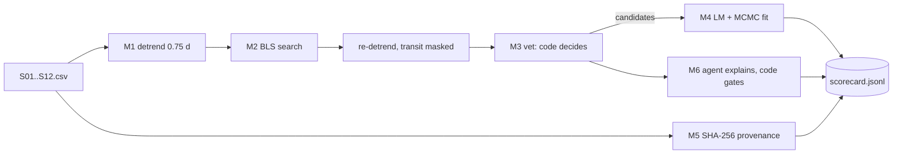

# Capstone: an exoplanet transit search pipeline — explained

## The intuition
The capstone joins the earlier labs into one pipeline over twelve synthetic TESS-like light curves: flatten slow drifts (detrend), search for periodic box-shaped dips (BLS), decide which dips are planets (vetting), measure them with honest errors (MCMC), record what went in (provenance), and let a local model explain — never decide.

The truth file (three planets, two eclipsing binaries, a spotted star, a ramp, five quiet stars) is used only for scoring.

**Analogy:** a CI/CD pipeline with stages, artefacts and gates, where the "tests" are physics checks and the release is a planet claim.
Where the analogy breaks: a false positive here is a wrong scientific claim, and the thresholds are tuned on synthetic data.



The one thing to remember: every claim leaves the pipeline only through a gate that code — not a model and not a person's hope — can check.

## Walkthrough: what actually happens when you run it
### Step 1 — the whole search
**You run** `python run_capstone.py`

**What happens inside** `pipeline.detrend()` divides by a 0.75 d running median; `pipeline.bls()` tries 6000 frequencies × 4 durations; candidates are re-detrended with the transit masked; `pipeline.vet()` applies the rules; `pipeline.fit()` reuses lesson 15's trapezoid and Metropolis sampler.

**What you see**
```
{"milestone": "M3 vetting", "pass": true, "candidates": ["S01", "S02", "S03"], "rejected": {"S04": "secondary eclipse at phase 0.5 (5217 ppm)", "S05": "odd/even depths differ (5937 vs 11603 ppm)"}}
{"milestone": "M5 provenance + reproducibility", "pass": true, "inputs_hashed": 12, "s01_sha256": "3a31a29c1689", "rerun_period_d": 3.1244}
{"milestone": "M6 agent explanation", "pass": true, "explained": 6, "published": [], "overclaims_blocked": ["S04", "S05", "S06"], "unverified_numbers": ["1.8"]}
{"scorecard": "PASS", "passed": 6, "total": 6}
```

**What it means / what would look wrong** Three planets kept, both binaries rejected with a stated reason, and every model text blocked (the fake model invents "1.8 Earth radii").

### Step 2 — the fits
**You run** the same command (M4 line).

**What happens inside** Each candidate is folded, fitted by Levenberg–Marquardt, then sampled with a free noise scale.

**What you see**
```
{"milestone": "M4 MCMC fit", "pass": true, "depth_minus_truth_in_sigma": {"S01": 2.22, "S02": -0.95, "S03": 0.9}, …
```

**What it means / what would look wrong** All within 3σ of the injected depths. A depth biased low would mean the detrender ate the transit.

### Failure lab (tryIt) — break a decision
**You run** `python try_it.py`

**What happens inside** It reruns one star each with a 0.25 d detrending window and with the odd/even rule switched off.

**What you see**
```
1. S03 window 0.25 d: period 12.3454 d, depth 726 ppm, SNR 6.69
2. S05 odd/even threshold inf sigma -> ('planet_candidate', [])
```

**What it means / what would look wrong** A short window eats S03's 4.2-hour transits (SNR below 10: lost). Without odd/even, the binary S05 becomes a "planet".

### The decision
**You run** nothing new: read decisions/0001-detrending.md, 0002-vetting-rules.md and 0003-agent-boundary.md.

**What happens inside** ADR 0001 compared 0.25 d (eats transits), 0.75 d unmasked (S02 depth −2.8σ) and 0.75 d with masking (−0.95σ): masking won. ADR 0002 set SNR ≥ 10, SDE ≥ 7, ≥ 2 transits, odd/even and secondary tests, and a derived duration bound. ADR 0003 lets the model explain only from a facts block.

**What you see**
```
{"milestone": "M1 load + detrend", "pass": true, "rms_over_noise": {"S07": 0.988, "S08": 0.973, "S09": 1.02, "S10": 1.0, "S11": 0.981, "S12": 0.996}}
```

**What it means / what would look wrong** Quiet stars stay at their injected noise: the detrender flattens without adding scatter. The fitness functions (`test_fitness.py`) keep the decisions true: 3/3 planets with period error < 0.1 %, 0 false positives among the other nine, depths within 3σ, and nothing gated published. `python -m unittest test_fitness -v` prints `Ran 4 tests in 174.210s` and `OK`.

## Common confusions
- **Q:** "The highest BLS peak is a planet." — **A:** S04 and S05 also peak; vetting rejects them.
- **Q:** "The model's explanation is part of the result." — **A:** `"published": []`: verdicts are fixed before the model is called.
- **Q:** "Periods within 0.05 % prove the depths." — **A:** depth needs masking (ADR 0001).

## Check your understanding
1. Why re-detrend with the transit masked?
<details><summary>Answer</summary>In-transit points pull the running median down, making transits look shallower.</details>

2. What does the odd/even test catch?
<details><summary>Answer</summary>An eclipsing binary at twice the BLS period: alternate eclipses differ in depth.</details>

3. Why does M5 hash inputs?
<details><summary>Answer</summary>So any result traces to exact input bytes and parameters (lesson 16).</details>
