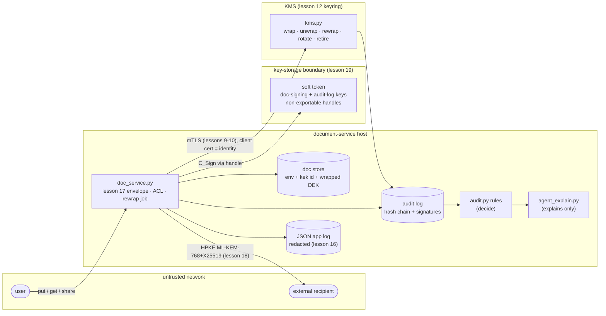

# 22 – Capstone: an encrypted document service

Read first: `content/concepts/L400/22-capstone-encrypted-document-service.md`. Full lesson: `content/L400.json` (lesson 22). Architecture: `architecture.mmd`.

## Design brief
A small company stores signed contracts, lets listed colleagues read them, shares some with external partners, and must later prove who read what. Hosts get compromised; insiders exist; quantum attackers may record shares.

Constraints:
- no plaintext DEK or document in the store; KEK only in the KMS
- KMS reachable only with a client certificate from our CA
- KEK rotation without re-encrypting data; no KEK retired while records need it
- audit log tamper-evident (edit, delete, reorder) and signed with a non-exportable key
- external shares quantum-safe (hybrid KEM); deprecated KEM refused for new shares
- 0 hard-coded algorithms, 0 key-export calls, 0 threat-model problems, 0 secrets in logs
- an agent may explain anomalies but never decide

## Architecture
Users call doc_service.py on the app host. For each document it creates a DEK, seals the document in lesson 17's envelope (AEAD id in the AAD header) and signs it through the token's doc-signing handle (lesson 19). It asks kms.py - a separate component holding lesson 12's versioned KEKs - to wrap the DEK over mutual TLS (lessons 9-10), where the caller's identity is its certificate CN. Every operation, including the KMS's, is appended to a hash-chained audit log signed through the token's audit-log handle; audit.py's rules decide anomalies and agent_explain.py only explains them. External recipients receive the DEK through HPKE ML-KEM-768+X25519 (lesson 18). The token PIN is loaded from a file and the JSON app log passes lesson 16's redaction filter.



## Run (same commands on macOS and Windows inside the activated venv)
```bash
python run_capstone.py          # scorecard (fake model explains)
python run_capstone.py --real   # optional: Ollama explains (LOCAL_MODEL_URL / LOCAL_MODEL)
python -m unittest -v           # 19 tests, one per milestone + end to end
```

## Expected output (observed locally: Python 3.12.15, cryptography 50.0.2 (OpenSSL 4.0.3 wheel), Linux sandbox)
```
{"milestone": "M1 envelope + versioned KEK + rotation", "crash_after": 3, "records_by_kid_after_crash": {"docs-kek:v1": 3, "docs-kek:v2": 3}, "retire_refused_while_in_use": true, "resumed": 3, "retired": "docs-kek:v1", "readable": "6/6", "pass": true}
{"milestone": "M2 mTLS between doc service and KMS", "doc_service_client": "ok", "no client cert": "refused (SSLError)", "cert from another CA": "refused (SSLEOFError)", "pass": true}
{"milestone": "M3 signed, hash-chained audit log", "entries": 50, "clean_log_anomalies": ["access_after_revoke", "unwrap_burst"], "tampered_at_seq": 10, "tampered_log_findings": ["access_after_revoke", "bad_signature", "chain_break", "seq_gap", "unwrap_burst"], "pass": true}
{"milestone": "M4 PQ-hybrid sharing (HPKE)", "kem": "HPKE-XWING", "pq": true, "recipient_opened": true, "wrapped_dek_bytes": 1168, "new_share_with_HPKE-X25519": "refused", "pass": true}
{"milestone": "M5 fitness functions + threat model + secret handling", "agility_lint_violations": 0, "key_export_calls": 0, "token_keys_exportable": 0, "threat_model_problems": 0, "secrets_in_logs": 0, "pass": true}
{"milestone": "M6 agent explains, code decides", "anomalies": 7, "accepted": 7, "rejected": ["A99"], "action": "page on-call (integrity)", "pass": true}
{"scorecard": "capstone", "passed": 6, "total": 6, "decided_by": "code"}
```

The KMS port, keys and certificates are random per run; everything else is seeded (SEED=22) and uses a fake clock.

Tests:
```
Ran 19 tests in 37.749s
OK
```

## Milestones
| # | Deliverable | Test |
|---|---|---|
| M1 Envelope encryption with versioned KEKs and rotation | put/get with per-document DEKs; rotate_kek + resumable rewrap; retire refused while records need the version | `test_m1_envelope_rotation.py` |
| M2 KMS behind mutual TLS | KMS over TLS with CERT_REQUIRED; caller identity from the client certificate | `test_m2_mtls_kms.py` |
| M3 Signed, hash-chained audit log + anomaly rules | audit-v1 entries signed via a token handle; verify_chain; burst / access-after-revoke / clock rules | `test_m3_signed_audit.py` |
| M4 PQ-hybrid sharing | HPKE MLKEM768_X25519 share of the DEK; recipient opens; deprecated KEM refused | `test_m4_pq_sharing.py` |
| M5 Fitness functions, threat model and secret handling | agility lint, no-key-export, token inventory, threat_model.json check, leak scan of logs | `test_m5_fitness.py` |
| M6 Agent explains, code decides | anomaly explanations through the secret gate; invented anomaly ids rejected; action decided by code | `test_m6_agent_explain.py` |

## Rubric
| Criterion | Measure | Pass |
|---|---|---|
| Confidentiality at rest | store holds only {env, kek, wdek}; wrapped DEK 60 B; plaintext absent from the store dump | test_m1::test_store_holds_no_plaintext_keys passes |
| Safe rotation | records_by_kid after a seeded crash; retire refused until 0 records | M1 retire_refused_while_in_use = True, readable 6/6 |
| Component authentication | KMS calls without a client cert / with a foreign CA cert | both refused (M2) |
| Tamper-evident audit | findings on an edited + truncated copy | bad_signature, chain_break and seq_gap all reported (M3) |
| Misuse detection | rules on the clean log | exactly access_after_revoke and unwrap_burst (M3) |
| Quantum-safe sharing | share KEM pq flag; deprecated KEM for new shares | pq = true, X25519-only KEM refused (M4) |
| Design stays true | agility violations, key-export calls, exportable keys, threat-model problems, secrets in logs | all 0 (M5) |
| AI boundary | explanations accepted only for code-reported anomalies | A99 rejected; action decided by code (M6) |

## Fitness functions
- No hard-coded algorithm outside the capstone registry (lesson 17) → `test_m5_fitness.py::TestM5::test_no_hard_coded_algorithms` (threshold: 0 violations)
- No private key bytes read outside the token; token inventory non-exportable (lesson 19) → `test_m5_fitness.py::TestM5::test_no_key_export` (threshold: 0 calls; 0 exportable keys)
- Capstone threat model checked by lesson 21's verified checker → `test_m5_fitness.py::TestM5::test_threat_model_clean` (threshold: 0 problems)
- No secrets in the JSON app log after a seeded leak attempt (lesson 16) → `test_m5_fitness.py::TestM5::test_no_secrets_in_logs` (threshold: 0 scanner findings)
- End to end scorecard → `test_run_capstone.py` (threshold: 6/6 milestones pass)

## Decision records
- `ADR-0022-1-kms-boundary-mtls.md`
- `ADR-0022-2-envelope-reuse.md`
- `ADR-0022-3-signed-audit-chain.md`
- `ADR-0022-4-pq-hybrid-sharing.md`

## Agent assist: the agent explains, code decides
Only anomaly lines (rule, seq, user, summary) are sent, after lesson 16's scan_log and lesson 9's SECRET gate. Explanations are ACCEPTED only for ids the rules reported; others are REJECTED; unexplained anomalies stay reported. Paging vs ticket is decided by code from the rule names.

`python agent_explain.py` (demo anomaly, fake model):
```
{'id': 'A1', 'verdict': 'ACCEPTED', 'text': 'rule unwrap_burst fired; check who triggered it and whether it was expected.'}
{'id': 'A99', 'verdict': 'REJECTED (no such anomaly)', 'text': 'entry 3 also looks suspicious to me.'}
```

python run_capstone.py --real uses Ollama (default qwen2.5:1.5b); wording varies, verdicts and actions still come from code. Not run in the sandbox (no model).

## Learning tool: Wireshark (pending a manual run)
Capture loopback while running run_capstone.py with SSLKEYLOGFILE set (as in lesson 10; the KMS client uses ssl.create_default_context): find the KMS handshakes, the CertificateRequest the KMS sends, and the client Certificate message.

Expected: Should match the lab's printed value: the doc-service client presents a certificate (handshake completes) while the 'no client cert' and 'cert from another CA' attempts end without application data (M2: both 'refused (SSLEOFError)'). Pending a manual run: the tool was not run in the sandbox; the value comes from the lab's printed output.

Install — macOS: brew install --cask wireshark-app (or the official universal .dmg) · Windows: Official x64/Arm64 installer from wireshark.org (bundles Npcap) · Licence: GPL-2.0 (OSI) · https://www.wireshark.org/download.html

## Learning tool: OpenBao (transit engine + web UI) (pending a manual run)
Production KMS equivalent: in a dev server, create transit key docs-kek, use datakey/wrapped to get a wrapped DEK, rotate, rewrap, then set min_decryption_version - the same story as M1.

Expected: 'vault:v1:' then 'vault:v2:' ciphertexts after rotate + rewrap, and refusal of v1 after min_decryption_version=2 - the service form of M1's 'retire_refused_while_in_use' and 'retired: docs-kek:v1'. Pending a manual run: the tool was not run in the sandbox; the value comes from the lab's printed output.

Install — macOS: brew install openbao (official install page), or podman run -d --name bao -p 127.0.0.1:8200:8200 docker.io/openbao/openbao:2.7.2 server -dev -dev-root-token-id=root -dev-listen-address=0.0.0.0:8200 · Windows: Container only (Docker Desktop / Podman), same podman run command; a native Windows binary was not checked · Licence: MPL-2.0 (OSI) · https://github.com/openbao/openbao/releases

## Learning tool: step CLI (smallstep) (pending a manual run)
Inspect the capstone's KMS client certificate: step certificate inspect <work dir>/pki/client.pem (print the path from service.start in a Python shell).

Expected: Subject CN doc-service, Extended Key Usage TLS Web Client Authentication, issued by 'KB Local Root CA' - the identity the KMS logs as 'doc-service/<user>' (test_m2::test_caller_identity_logged). Pending a manual run: the tool was not run in the sandbox; the value comes from the lab's printed output.

Install — macOS: brew install step · Windows: winget install -e --id Smallstep.step (manifest at 0.30.6) or step_windows_0.31.0_amd64.zip · Licence: Apache-2.0 (OSI) · https://github.com/smallstep/cli/releases

## Extend it
Pick one: dual-sign documents (ADR-0017 transition phase) once the token supports ML-DSA; ship audit entries off-host; reuse KMS connections; add a revocation that clears the ACL cache. Add a milestone line, a test and an ADR.

## If it fails
| Symptom | Action |
|---|---|
| PermissionError: KeyInUse ... still wraps N record(s) | Expected before the rewrap job finishes; run svc.rewrap() first. |
| SSLEOFError for your own client | The client did not load client.pem/client-key.pem from the capstone PKI. |
| Leftover tmp* folders in the lab | Only on file systems that refuse fast deletes (e.g. network mounts); safe to delete. |
