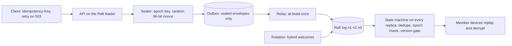

# Post-quantum secure messaging over a replicated log

## Why combine these
Each topic already has a correct building block: a hybrid X25519+ML-KEM-768 exchange with AES-GCM, a Raft log that
survives leader crashes, and idempotency keys, an outbox and versioned contracts. Each passes its own tests. Put them together and new failures appear that none of those tests can see. AES-GCM is safe only while
a (key, nonce) pair is never reused, and Raft happily elects a new leader that knows nothing about the old leader's
memory. An idempotency key stops duplicate *effects*, but every re-sealed retry is a *different* ciphertext. A
versioned envelope is fine for one reader, but replicas that disagree on which versions are valid stop being
replicas. This project builds a small group-messaging service to expose those seams, break them on purpose, and keep them
closed with fitness functions.

## Architecture walkthrough

The leader's API checks the replicated state for the client's Idempotency-Key, then the sealer encrypts under the
current epoch key. The envelope header (`v, aead, kem, epoch, sender, ikey, n`)
is the AAD. The sealed envelope, never the plaintext, is written to the node's outbox. A relay proposes it to Raft until
it commits. Every replica applies the committed prefix with the same deterministic code. That code accepts the first
entry per key and drops duplicates, refuses envelopes from an old epoch, and refuses versions the log has not enabled.
Member devices, and the sealer on any new leader, learn epoch secrets by replaying the log. Each epoch entry carries one
hybrid welcome per member: an ML-KEM-768 + X25519 encapsulation to the member's 1,216-byte key package, wrapping the
32-byte epoch secret. Replicas hold no keys.

## The seams
**Nonce uniqueness vs leader failover (crypto ↔ distributed).** The nonce is part of the crypto, but its uniqueness
depends on who seals and what survives a crash. A counter in the leader's memory restarts at 1 on every new leader under
the same key. The defence is either no state (random 96-bit nonces) or state that consensus already makes unique
(term ‖ counter, valid only while one leader per term seals).

**Key rotation vs log replay (crypto ↔ distributed).** Rotation must be replayable, so the epoch secrets travel in
the log as welcomes. Envelopes name their epoch, and readers keep one key per epoch. Log order also defines
membership. An envelope sealed before a removal but committed after it must be rejected, or the removed member reads
a message the group sees as "after".

**Idempotent retries vs duplicate ciphertexts (app-arch ↔ distributed).** With random nonces a retry that is sealed
again is a new ciphertext, and the outbox relays at least once. Byte equality cannot find duplicates, and a dedupe
table in leader memory dies with the leader. The key and a keyed fingerprint go into the log, and the state machine
dedupes them, as the Raft paper's session table does.

**Envelope contract vs replicas (app-arch ↔ crypto).** Writers, readers and the state machine all read the header.
A reader contract catches renamed fields. The set of accepted versions is replicated state, switched by one log entry,
so every replica changes at the same index.

## Worked run
`run_project.py` passed 13 of 13 lines. M1: the three members and the sealer derived one epoch secret. A key package is
1,216 B and a welcome 1,180 B, so F3's 2,396 B is under the 2,400 B budget. A welcome cut to its 32-byte X25519 part was
refused with HandshakeError. M2: 30 messages with a leader crash gave identical committed logs (31 entries), no
plaintext in any log, and 30/30 readable on every replica. M3 returned 400, 201, 200, 422. A crash after the outbox
write produced 503, and the retry produced 201. The log then held 2 ciphertexts for that key, and readers saw 1. M4: after
carol's removal a fresh device replays 20/20 for alice and bob and 10/20 for carol. The one late epoch-1 envelope was
rejected. M5: v3 (ChaCha20-Poly1305) was refused with 409 before the gate entry and accepted after it, with 4 readable
messages on each replica. F1/F2: 10,000 messages and 205 seeded leader crashes gave 10,101 sealed ciphertexts, 0 reused
nonces and 3 identical replicas showing exactly the 10,000 acknowledged messages. With `--inject leader-counter`, 1,500
messages and 49 failovers gave 109 reused nonces, with values 1, 2, 3, ... The keystream XOR recovered "msg 00010 from
bob: status green" from a known message.

## Failure modes at scale
Random nonces cap each epoch key near 2^32 messages (NIST SP 800-38D). At 10,000 messages/s that is about five days,
so rotation becomes a volume-driven event and not only a membership event. Watch messages per epoch. Welcomes grow
linearly: 100 members make a 164,659-byte epoch entry, replicated to every node. Large groups need a ratchet tree
(MLS). Without snapshots every restart replays the whole log. In the 10k run that dominated the cost. The dedupe table also grows without bound until keys expire.

## Common mistakes
1. **Treating the nonce as local state.** Anything that sets the nonce (a counter, a seeded PRNG, a clock) has to survive
   failover and restart, or must not exist at all. Test with failovers, not in one process.
2. **Deduplicating by ciphertext or in leader memory.** Under randomized encryption the same message has many
   ciphertexts. Dedupe must use a key, and that key must live in replicated state.
3. **Rolling out a format change by config.** One node accepting v3 before the others makes replicas diverge. Gate
   versions through the log, ship readers first, and keep refusing unknown versions with no fallback.
