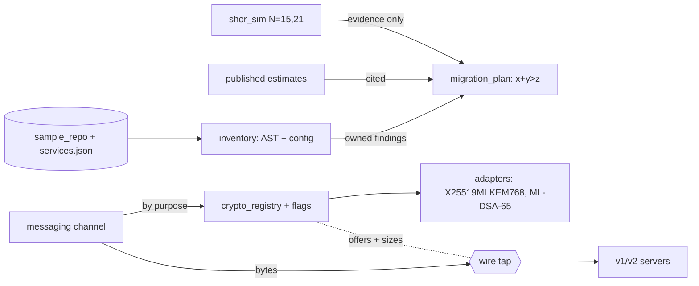

# Quantum-safe migration: from Shor in a simulator to a crypto inventory

## Why combine these
Each topic alone tells half the story. The quantum topic shows *why* RSA and elliptic curves fall (order finding),
but a 15-qubit simulation says nothing about *when*. The cryptography topic gives the replacements (ML-KEM, ML-DSA,
hybrids), but not *where* they are needed in a real codebase. Application architecture gives the means to change many
services safely (ports, a registry, flags, fitness functions), but not *which* change matters first. A migration
needs all three, and it fails at the joins: a toy result read as a timeline, an inventory finding that no plan row
picks up, a service that looks migrated in the code but is not on the wire.

## Architecture walkthrough

`shor_sim.py` runs order finding on the quantum topic's numpy statevector (no Qiskit): t = 2⌈log2 N⌉ counting qubits,
a work register in |1>, controlled multiplications, the inverse QFT from lesson 25, and continued fractions. The
oracle is *compiled*: it already uses a^(2^j) mod N, and for N = 15 the gate-level version skips powers that equal 1 -
exactly the shortcut Smolin, Smith and Vargo warned makes small demos look bigger than they are. `estimates.py` holds
only published numbers with their sources. `inventory.py` reuses the quantum topic's AST scanner and adds config rules
(nginx, JSSE, JWS) and registry calls. `migration_plan.py` joins findings with each service's data lifetime x and
migration time y and applies Mosca's inequality against a labelled z. The migrated messaging service names no
algorithm: it asks `crypto_registry.py`, which reads policy and two owned, expiring flags and returns adapters;
`fleet.py` runs v1 and v2 servers through four rollout phases while `wire.Tap` records every flight.

## The seams
**Quantum -> risk model.** The contract is "mechanism, not timeline". A simulator result carries a `scope` string,
`Horizon` refuses anything but a planning assumption or a policy date, and every RSA-2048 statement must cite a paper.
The risk is over-claiming in either direction: "they factored 21, so we are fine" or "qubits double yearly, so 2031".

**Inventory -> plan.** Findings cross as `{file, line, algorithm, usage, service}`. The plan needs x and y from the
service manifest; a file that no service owns would silently vanish from a join, so it becomes `P1-review` instead.

**Agility layer <-> wire format.** The registry promises a group and sizes (1216/1120 B for X25519MLKEM768, 3309 B for
ML-DSA-65); the seam test reads the bytes and compares. Static checks see code; this seam sees behaviour.

**Rollout flags <-> crypto policy.** `pq_required` changes what clients offer and what v2 servers accept. Flip it
while a v1 server remains and those handshakes must be refused, never downgraded.

## Worked run
`python run_project.py` (seed 2026, fake clock 2026-10-30) printed: N = 15 on 12 qubits, P(success per run) = 0.5,
101/200 seeded shots gave 3 x 5; the CX/CCX oracle (14 CX, 5 CCX) gave the identical distribution. N = 21 on 15
qubits: P = 0.3222, 66/200 shots gave 3 x 7; both match lesson 25's closed form. The statevector for 15 qubits is
512 KiB; RSA-2048 appears only as cited text: 20 million noisy qubits in 8 hours (2019) and less than a million in
less than a week (2025). The inventory found 10 uses with recall = precision = 1.0 (a docstring mentioning RSA and a
commented nginx line were correctly ignored). With z = 10: three P1 items - messaging X25519 (12 + 2 - 10 = 4),
payments RSA-3072 key wrap and the payments TLS groups (10 + 3 - 10 = 3); records (7 + 3 = 10) is P2 because the
inequality is strict. After migration, messaging is `done`, the hybrid client flight is 1,352 B and the handshake
5,871 B (budget 1,400 / 6,144). Rollout: all-v1 gave 6 X25519 sessions, mixed 4 hybrid + 2 classical, all-v2 with
`pq_required` 6 hybrid, and a rolled-back v1 server 2 refusals and 0 classical sessions.

## Failure modes at scale
- **Invisible bypass.** `--inject bypass` loads X25519 by module name. Inventory, F1 and the lint stay green; S3
  reports "offered ['X25519'], registry says ['X25519MLKEM768', 'X25519']" and F3 counts 0 registry resolutions for
  24 handshakes. Left alone, it breaks loudly later: all 6 sessions refused when `pq_required` turns on.
- **Downgrade during rollout.** `--inject downgrade` re-adds X25519 when PQ is required; the leftover v1 server accepts
  it and S4 counts 2 classical sessions.
- **Simulator wall.** Memory doubles per qubit; the shared `sv.run` without an explicit state allocates a 2^n x 2^n
  identity (16 GiB at 15 qubits) - this lab passes |0> explicitly.
- **Size creep.** ML-DSA-87 lifts the handshake to 7,145 B and F2 fails; certificate chains would add more.

## Common mistakes
1. Treating a compiled-oracle demo as progress toward RSA-2048. Gate counts for N = 15 measure the demo, not the
   threat; quote published estimates with their assumptions instead.
2. Trusting a static inventory as proof of migration. Code that loads modules by name, defaults in TLS libraries and
   vendored binaries escape it; check the wire.
3. Writing `x + y >= z` or picking an optimistic z. The boundary case changes priorities, and z = 15 empties the P1
   list - keep z labelled and test the plan across a range.
