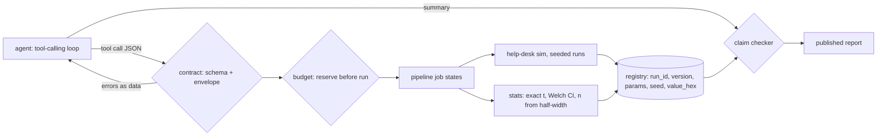

# An AI agent that runs simulation experiments — and can't fool you

## Why combine these
A simulation answers "what if" questions. An agent makes asking them cheap: it reads a brief, proposes screening runs and A/B experiments, and writes a summary a manager will act on. The trouble starts where they meet. A language model writes fluent numbers and confident words like "significant", while a stochastic simulation produces noisy estimates whose meaning depends on replications, seeds and the model version. Put a model's prose on top of a simulator's noise and you get a convincing report that nobody can check. Application architecture supplies the fix, which is structural: a job pipeline with a contract at its entry, a budget gate, an append-only registry and a checker at its exit. The agent proposes and explains. Deterministic code decides what runs, how many times, what it costs and which sentences get published.

## Architecture walkthrough

`agent.py` is the ai-agents L100 #6 loop: model, tool call, result, model. The L300 #14 `Budget` caps it at 8 calls. `contract.py` holds two tool schemas and checks them with the L200 #8 validator. The same dict is sent to the model as `tools`, so the two cannot drift. `pipeline.py` moves each job through PROPOSED → VALIDATED → PLANNED → RAN → ANALYSED → DONE (or REJECTED). The simulator is the L200 #10 help desk (`warmup.waits`, an M/M/1 queue with a 30-ticket backlog). Its replication i of arm k gets the seed `SeedSequence(root, spawn_key=(k, i))`. Screening reuses the L300 #14 Morris code through an adapter. The registry stores each run as JSON lines: `run_id = sha256(model, version, params, seed)`, plus the result as `float.hex`. `claims.py` reads the agent's summary one sentence at a time.

## The seams
**Agent ↔ tool schema.** What crosses this seam is JSON arguments. The risk is values that are valid JSON but invalid science. The agent proposed lam 0.97, and the schema maximum of 0.95 rejected it. A rule no schema can express, lam/mu ≤ 0.9 (the envelope verified in M1), is checked in code. Rejections return as tool results and cost nothing.

**Agent claims ↔ computed statistics.** What crosses this seam is text. Every sentence with a number must cite an `[exp-…]` id. Its numbers must match that experiment's facts at the precision written, and its words ("significant", "cut", "not significant") must agree with the computed verdict. The fake agent's "about 32.3 min" at lam 0.97 cited nothing (that run never happened), so it was dropped.

**Simulation stochasticity ↔ conclusions.** Three replications measure noise. The pipeline ignores the agent's count. It runs a pilot of 10, then extends to n·(h/target)² until the 95% Welch half-width of the difference is ≤ 0.3 min.

**Cost/time budget.** Cost is counted in simulated customers and reserved before any run. Sobol' with N = 64 (384 runs × 1,000 customers) needs 384,000 and is refused with 300,000 available. Morris with r = 10 needs 50,000 and runs.

## Worked run
`python run_project.py` with the fake model, seed 13:
- **M1.** The model's 95% CIs cover the M/M/1 formula at ρ 0.5, 0.8 and 0.9: 0.992 ± 0.038 vs 1.0, 3.894 ± 0.229 vs 4.0, 8.491 ± 0.817 vs 9.0.
- **Screening.** Morris ranks mu (μ* 1.72) and lam (1.53) above warmup (0.74) and backlog (0.54).
- **Experiment.** The agent asked for 3 replications. The ledger shows 3 → 10 → 47 → 55. The mean wait drops from 4.04 to 3.14 min, a difference of -0.895 ± 0.293 (-22%). That is a significant decrease, and the steady-state truth (-0.952) lies inside the CI. Cost: 220,000 customers. Session total: 270,000 of 300,000.
- **Claim check.** 4 sentences. 3 pass with 7 of 7 numbers traced. 1 is rejected.
- **Reproducibility.** All 160 registered runs reproduce bit-for-bit.

Then `--inject few-reps`, where the pipeline trusts the agent's 3. The means are 4.28 vs 2.58 (-40%), the arm CIs overlap, and the difference CI runs from -3.436 to 0.019. The agent still writes "a significant improvement with 3 replications". The checker rejects it and publishes a code line ending "inconclusive". M4 and the stochasticity seam fail, the scorecard is 10/12, and the exit code is 1.

## Failure modes at scale
- **Cost.** At about 4,000 customers per replication pair, a tighter target grows as 1/h². A ±0.2 target needs 105 per arm, so the pipeline stops at 10 with `budget_limited`. Common random numbers give ±0.266 with 10 runs (correlation 0.963), but they need a paired analysis.
- **Many comparisons.** An agent that runs 20 A/B tests will find a "significant" one by chance. Each CI is 95%, not the family. Bonferroni or ranking-and-selection procedures (simulation L400 #18) are next.
- **Reproducibility across machines.** Bit-for-bit only holds within one environment fingerprint. `expovariate` uses the platform's `log`, and Python only guarantees `random()`'s sequence across versions.
- **Mislabelled claims.** Number matching is by value. A correct number quoted as the wrong quantity still passes; fact names in `traces` make that reviewable, not impossible.

## Common mistakes
1. **Checking numbers but not words.** All of "-40%, significant improvement" traced to registry facts. Only the verdict check caught that it was not significant.
2. **Letting the agent pick n.** The replication count is a statistical decision, not a preference. Here 3 replications reported almost twice the 55-replication gain (-40% vs -22%).
3. **Seeding by call order.** If seeds come from a running counter, extending 3 → 55 replications changes the first three runs. Keyed streams keep them identical, so they keep the same run ids and stay comparable.
