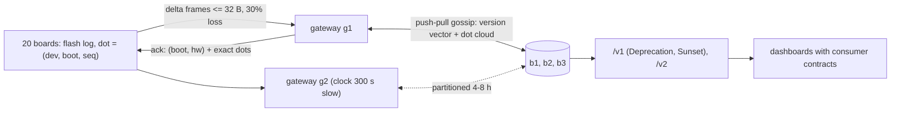

# An offline-first micro:bit sensor fleet

## Why combine these
The microbit labs read temperature and light, send radio frames and model a battery. The distributed-systems labs prove that a CRDT merge converges. The application-architecture
labs version an API and verify consumer contracts. Real systems fail between those parts: a 32-byte radio frame
meets a replication protocol that wants to ship state, a board without a real-time clock meets a database keyed
by timestamp, and a firmware rollout meets a dashboard that still reads /v1. This project joins 20 simulated
boards, 2 gateways, 3 backend replicas and a versioned API, then injects the faults that only appear at those
joins.

## Architecture walkthrough

Each board samples once a minute and appends the reading to a flash log before anything else happens. That is
offline-first: the radio is only a way to empty the log. Every 10 samples the board turns the radio on. It sends
unacked records, oldest first, three per 30-byte frame, and listens 50 ms for acks. Then it turns the radio off,
because a board in Deep Sleep cannot hear anything. A gateway decodes a frame by the schema byte and stores
the records in a durable dot store. Its ack holds two things: (boot, contiguous high-water mark) per boot, and
the exact dots from this frame that sit above that mark. The board deletes only records that an ack covers.
Every 5 minutes each gateway and replica swaps deltas with one random reachable peer; the peer's digest
(version vector plus dot cloud) says what it already has. The API serves replica b1.

## The seams
**Radio length and CRDT state.** A full state-based sync of one board's 12-hour log is 6,480 B, which is
224 frames. One sync attempt sends at most 24 records. Frames stay under the radio's configured length,
because the sender truncates anything longer without an error. The gateway rejects any body that is not a whole
number of records. A bad frame is dropped and resent; it is never half-parsed.

**Device clock and ordering.** `running_time()` restarts at 0 after a reboot. The board's wall time comes from
the epoch in the last ack, so it also jumps whenever the board hears the slow gateway. In the seeded run,
1,421 (device, wall-second) keys repeat. Identity is the dot, and per-device order is (boot, seq). Wall time is
only a display field.

**Battery and sync frequency.** The board sleeps between samples, so the board must start each sync. The
microbit L300 #14 model costs every awake millisecond at 30 mA. The sync interval moves life a little, from
2,212 h (every minute) to 2,445 h (hourly). The assumed 0.5 mA sleep floor matters far more than the interval.

**Firmware schema and backend contract.** Four boards still send schema-1 records (8 B, no light). The first
byte of every frame selects the record layout, and a test compares the firmware and gateway layout tables. The
v2 consumer contract requires `"schema": 1, "light": null` for such a board.

**CRDT state and API paging.** Gossip can deliver seq 4 before seq 3. `/v2/.../readings` serves only the
contiguous prefix of each boot (`stableThrough` = the version-vector mark). A client paging with `after=` can
never skip a reading that arrives late.

## Worked run
`python run_project.py` (seed 4, simulated 12 h plus a drain) printed 12/12 PASS. All 14,400 readings reached a
gateway through 30 % loss, 5 % duplicates and 5 % reordering. That took 9,752 frames in 2,835 attempts. Boards
d15-d19 were out of range for 3 h, and their logs peaked at 190 records (capacity 400). After the drain the
three replicas and two gateways held identical states, with 0 lost and 0 wrong values. The merge passed
300/300 seeded law checks. In 200 gossip experiments, 5 replicas agreed in at most 3 rounds (mean 2.27).
Both contracts verified. The worst board's modelled life was 2,419.7 h (target 2,000 h).

The failure lab swaps the dot store for a time-series row keyed (device, wall second), last write wins. This is
what InfluxDB documents for duplicate points. `--inject wallclock-lww` gives FAIL 9/12 with 1,421 readings lost.
That equals the number of repeated wall keys, and d07's reboot accounts for part of it. Both API contracts
still pass, and the replicas still converge. They converge on the wrong data, so nothing alarms except the
completeness check.

## Failure modes at scale
- **Partitions longer than the flash log.** 400 records hold 6.7 h at one per minute. An 8-hour partition in
  try_it dropped 451 records and lost 450; one had reached a gateway, but its ack had not arrived.
- **Gaps stall the prefix.** A dropped record never arrives, so `stableThrough` stops at the gap. Devices
  must report dropped ranges, or the API needs a gap tombstone.
- **Airtime.** The stub has no collisions or airtime. With hundreds of boards per gateway, staggering and a
  listen-before-talk policy matter more than the frame size.
- **Digest growth.** The digest grows with (device x boot) entries and with gaps. Thousands of devices need
  sharded digests or Merkle trees.

## Common mistakes
1. **Keying readings by timestamp.** Clocks on cheap devices step backwards. Use a per-device counter with a
   persisted boot number, and treat time as data.
2. **Acking only a contiguous mark.** One missing record then blocks every later ack. The board resends
   until its log overflows. Before selective acks, the 8-hour partition lost 2,330 readings instead of 450.
3. **Treating contract tests as completeness tests.** Contracts check shape. Only a fitness function that
   compares sampled with stored readings catches silent loss.
