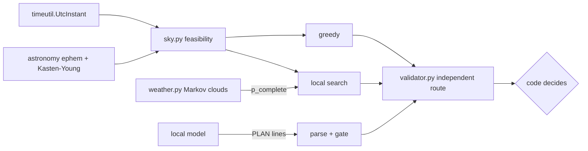

# L600 #05 · A robotic-observatory night scheduler

## Why combine these
A small robotic telescope makes one decision every night: which requests to observe, and when. Astronomy supplies the hard constraints (altitude, airmass, darkness, distance from the Moon). Simulation supplies the uncertainty: clouds arrive in spells, so a 3-hour block is a riskier promise than a 1-hour one. AI agents supply a useful but untrusted voice: a local model can draft a plan or explain trade-offs to an observer in plain words, but it does not compute altitudes. Each topic works on its own. The failures show up where they meet: a local time handed to code that expects UTC, a plan written by a model that nobody re-checks, a scheduler that promises a nominal value while the weather pays out much less. This project builds the scheduler and then guards every boundary with a test.

## Architecture walkthrough

`sky.py` builds 64 ten-minute slots of astronomical darkness (Sun below −18°) for Gurgaon on 2026-11-19 and a feasibility matrix: request *i* may start at slot *s* only if every block boundary has airmass ≤ 2.0 (Kasten & Young, infinite below the horizon) and lies at least 30° from the Moon. The greedy dispatcher starts the highest-priority feasible request at each free slot. The local search permutes the request order, decodes each order by earliest fit, and maximises *expected* value: the sum of priority × P(block completes). That probability comes from the weather model: a two-state Markov chain with P(clear→cloudy) = 0.04 and P(cloudy→clear) = 0.20 per step. A block of *n* slots survives with probability π(1−a)^(n−1), where π = 0.833. The validator never trusts the scheduler. It recomputes altitude through apparent sidereal time (the astronomy L100 route checked against Wallace & Capitaine 2006) every 5 minutes, and it also checks the Sun, the Moon, overlaps and grid alignment. Agent plans pass through the same validator.

## The seams
**Time (astronomy ↔ scheduler).** People plan in local time and sky maths needs UTC. `UtcInstant` refuses naive datetimes and non-UTC offsets, and converts only with `astimezone`. Because a relabelled clock still has offset zero, types alone cannot catch a relabel. The seam test therefore re-validates every scheduled block at its published UTC time.

**Agent ↔ validator.** Model text becomes `UtcInstant` rows or is rejected. Unzoned times fail to parse, and below-horizon or high-airmass blocks fail validation. A valid agent plan is adopted only if it promises at least the optimiser's value. Explanations are published only if every number appears in the facts.

**Weather ↔ promises.** The scheduler promises p_complete for each block. In 1000 simulated nights, each block must complete within 3 binomial standard errors of that promise, and the mean value must fall inside its 95 % confidence interval.

**Units.** RA and Dec are in degrees, sidereal time in hours (×15), trig functions take radians, and exposures are counted in minutes. The transit identity (altitude = 90° − |φ − δ| at hour angle 0) and the agreement between the two altitude routes (< 0.02°) catch a missing ×15 at once.

## Worked run
`python run_project.py` prints 12 PASS lines. Darkness runs 18:50–05:20 local (13:20Z first slot). Seven of eleven requests can be scheduled at all. Polaris never gets below airmass 2 (altitude ≈ 28.5°), Canopus never rises high enough, Arcturus rises only near dawn, and Fomalhaut stays closer than 30° to the Moon for its whole window. Greedy takes Deneb at dusk, which loses Vega, and ends at expected value 8.209. The local search fits Vega in first, then Deneb, Aldebaran, Betelgeuse and Sirius, for 10.534. Over 1000 common-random-number nights the means are 8.261 ± 0.272 and 10.494 ± 0.306, a ratio of 1.27, with a paired difference of 2.233 ± 0.190. Greedy still wins on 17.8 % of nights, which is why the plan comes with a probability and not a guarantee. Betelgeuse's 180-minute block is the riskiest promise, at p = 0.416. The fake agent's plan is rejected for four reasons, including Betelgeuse at −16.4° altitude and an unzoned time. The same optimiser plan written in +05:30 time is accepted.

## Failure modes at scale
- **More telescopes and requests.** The feasibility matrix grows as requests × slots × sites, and order search loses quality. You will notice that the plan changes with the seed, or that runs time out. Move to an ILP/CP model (as Las Cumbres did) and keep the validator as the judge.
- **Real weather.** Fixed Markov parameters drift with the season. Realised completion rates fall outside the promised 3σ band night after night. Refit a and b from site logs and re-plan when clouds roll in.
- **Ephemeris precision.** J2000 coordinates without precession (≈0.36° by 2026) and low-precision Moon positions are fine at airmass 2, but not near a limit. Compare blocks within 0.5° of a limit against astropy (the cross-check is listed in pendingCi).

## Common mistakes
1. **`replace(tzinfo=timezone.utc)` on a local time.** It relabels the clock and does not convert it. The failure lab moves the sky by 330 minutes, while the scheduler's own airmass column still looks fine (1.982).
2. **Optimising nominal priority instead of expected value.** Long, high-priority blocks look great until clouds arrive. Promise p_complete, and check that promise by simulation.
3. **Letting the agent's plan through because it "looks reasonable".** Every plan, including the optimiser's own, passes through the same independent validator, and the validator never repairs a plan.
