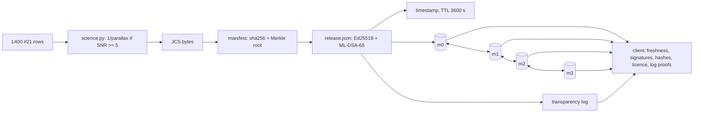

# L600 #06 - A verifiable, replicated science-data release pipeline

## Why combine these
Each topic alone has a tidy story. Astronomy turns a parallax into a distance. Cryptography signs a manifest of
SHA-256 digests. Distributed systems spreads data to replicas until they agree. A real data release needs all three
at once, and none of the three stories mentions the others' assumptions. The astronomer writes doubles and never
thinks about bytes. The signer treats bytes as sacred and never thinks about the JSON stack in the middle. The
replication layer cares about "the same value" eventually, not "the same bytes". Users meanwhile cite a version for
years and fetch it from whatever mirror is close. The project's claim is simple: integration fails at the joints,
so each joint gets an explicit contract, a test, and a fault you can inject on purpose.

## Architecture walkthrough

`science.py` reuses astronomy L400 #21's synthetic Gaia-like rows and L100 #4's unit functions. It publishes a
distance only when parallax/error >= 5, because inverting a noisy parallax gives a biased distance. The publisher
runs L400 #21's licence rule first: Gaia's CC BY-NC 3.0 IGO forces CC-BY-NC-4.0. Then it writes five files as
RFC 8785 (JCS) bytes and lists each file's SHA-256 and length. The manifest also carries an RFC 9162 Merkle root,
the licence and the hash of the acknowledgements. The release is signed under cryptography L400 #17's "transition"
policy (Ed25519 and ML-DSA-65 both required). Its hash goes into an append-only log, and a short-lived timestamp
names it as the newest release. Only mirror m0 gets the upload. Push-pull gossip compares a Merkle tree over 16 key
buckets and copies only what differs; distributed L400 #17's seeded `Sim` drives the rounds. The client trusts one
root.json and checks everything else in the TUF order.

## The seams
**Floats to hashes (astronomy to cryptography).** The catalogue is full of doubles. A signature covers bytes, and
two honest JSON writers can print one double in two ways. The contract: hash and sign JCS bytes, keep re-encoding
idempotent, and parse strictly.

**Rotation to old releases (cryptography to distributed systems).** Mirrors keep v1 forever, so its key must stay
checkable after rotation. The contract: retired keys stay in root.json with `valid_through_version`, and root N+1
is signed by root N and N+1.

**Mirror lag to freshness (distributed systems to cryptography).** A lagging mirror is honest but old, and a
frozen one looks the same. The contract: the client never goes below the highest version it has seen, refuses
expired timestamps, and the TTL must exceed the re-sign interval plus replication lag plus clock skew.

**Licence to release (astronomy to cryptography).** The licence gate runs before signing. The licence and the
attribution hash sit inside the signed manifest, so a mirror cannot strip the Gaia credit unnoticed.

## Worked run
`run_project.py` passes 12/12. Release v4 has 28 rows. Ten are `needs-prior`; the first star has 3.6941 mas and
lands at 270.70193010476163 pc. The catalogue is 6,536 bytes as JCS and would be 7,901 through a '%.17g' writer.
Signatures are 64 + 3,309 bytes. All 15,586 single-bit flips across the six v4 objects are rejected. Gossip
converges in at most 3 rounds over 100 seeds (mean 2.04), and in 1 round after m3 returns from a 3-round partition.
The lagging snapshot of m3 is refused with "offers v3, client has seen v4 (rollback)". After 6,000 s it is refused
as "timestamp expired". With `--inject float-format`, m2 stores `-3.9415300000000002` where m0 has `-3.94153`. No
round ever converges, conflicts pile up on the catalogue keys, and the client rejects m2 with "catalogue.json
missing or changed": FAIL 9/12. TryIt 2 shows the reverse coupling. With a TTL of 120 s, honest mirrors are
unusable 300 s after a publish ("timestamp expired at 3720").

## Failure modes at scale
- **One file per release.** Gaia DR3 has ~1.8 billion sources. You would chunk the catalogue, give each chunk a
  Merkle leaf, and let anti-entropy repair per chunk. Otherwise every version re-ships everything.
- **Bucket fan-out.** With millions of objects, 16 buckets each hold huge key lists, so a single change ships a
  bucket's full listing. Deepen the tree, as Dynamo does per key range.
- **Freshness under load.** When replication lag nears the TTL, "timestamp expired" refusals rise in step with gossip
  rounds. Re-sign more often or serve timestamps separately.
- **One log, many views.** Consistency proofs protect one client's history. Detecting a log that shows different
  trees to different clients needs witnesses that compare tree heads.
- **Clocks.** Freshness assumes a roughly correct client clock. TUF lists bogus clocks as an open problem.

## Common mistakes
1. **"Sorted keys and no spaces is canonical."** Python's `json.dumps` agrees with JCS on today's catalogue only by
   luck: after a JCS parse, whole numbers are ints. It writes 5.0, 2.5e-05 and 1e-07 where JCS writes 5, 0.000025 and
   1e-7 (tryIt 1). The build task fixes the number layout against RFC 8785's own samples.
2. **"Signatures don't expire, so rotation is free."** Dropping the old key from root.json leaves only v4 verifiable.
   Keeping it fully trusted lets a thief sign v5. The validity window is what makes rotation safe.
3. **"A valid signature means a good download."** A replayed v3, or a frozen mirror, carries perfectly valid
   signatures. Only version monotonicity, expiry and the log say whether the release is the newest one.
