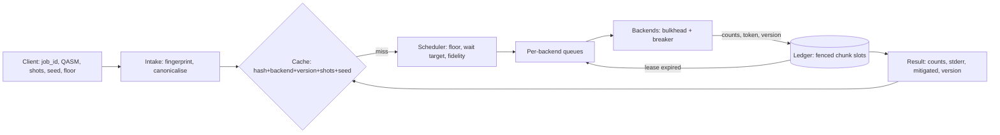

# L600 #07 — A reliable quantum-job service on unreliable backends

## Why combine these
A quantum result is a statistic: counts from N shots, an estimate with an error bar, valid for one device calibration.
A job service is a distributed system: requests are retried, messages are delivered at least once, workers stall,
backends fail. Application architecture decides how the two meet: a queue to level load, a breaker and a bulkhead per
backend, a cache, a result contract. Each topic is sound on its own. The bugs live where one topic's normal behaviour
violates another topic's assumption: a redelivered chunk is routine for the queue but corrupts N for the statistician;
two texts of one circuit are equal for physics but different for a hash; a recalibration is routine for the device but
silently stales every cached result.

## Architecture walkthrough

Intake treats `job_id` as an idempotency key: same body replays the job, a different body is a conflict (HTTP 422 in
the IETF draft). `canon.py` parses with the quantum topic's OpenQASM reader, cancels adjacent self-inverse pairs and
sorts gates inside ASAP moments, then hashes. The scheduler filters healthy backends by the client's fidelity floor,
prefers those whose wait estimate is under 15 s (half the 30 s p95 budget), and picks the best estimated fidelity.
Shots are split into 1000-shot chunks queued per backend; a backend runs at most `slots` chunks (bulkhead) and sits
behind the application-architecture `CircuitBreaker`. Each chunk attempt gets a lease (10 s) and a fencing token from
one growing counter. Completions go to the ledger, which accepts one result per chunk and one calibration per job.

## The seams
**Retries ↔ shot accounting.** At-least-once delivery means a chunk can execute twice. If both results are merged,
N grows, the distribution over-weights the duplicated chunk and the error bars shrink for no reason. The fix is
idempotent attempts (same seed per chunk, never per attempt) plus fencing (a lower token cannot overwrite a higher one).

**Canonicalisation ↔ cache key.** Equivalent circuits must share a key, inequivalent ones never. Each rewrite rule is
checked by comparing unitaries on the statevector simulator; permuting qubits or adding an idle qubit changes the key.

**Noise ↔ result contract.** A count without uncertainty invites over-reading. The contract requires per-outcome
standard errors, and mitigated values carry a propagated covariance A⁻¹ Cov A⁻ᵀ, which is larger than the raw one.

**Calibration drift ↔ cached results.** Calibration version is part of the key, and a job whose chunks straddle a
recalibration restarts on the new version, so no result mixes two devices.

## Worked run
`python run_project.py` (seed 7, 240 jobs, 0.8 jobs/s, 29 client replays, a 40 s outage on flaky-mid, slow chunks
on slow-clean, recalibrations at 150 s and 220 s): all 240 jobs return exactly their requested shots (590,000 total)
after 405 attempts, 15 lease expiries and 4 breaker openings; 2 stale commits were rejected
(`REJECTED (token 1 < 3)`). The cache served 108 jobs, 46 of them from a textually different variant, with 0 version
crossings. p95 queue time is 18.38 s against a 30 s budget. For a 4000-shot Bell pair on fast-noisy, raw TVD to the
pre-readout distribution is 0.0653 and mitigated 0.0098, while the standard error of P(00) grows from 0.007898 to
0.008486. Error bars are honest but not perfect: 93.62% of the reported 95% intervals cover the exact noisy
probability. Counting every outcome of executed jobs, unobserved ones included, the Wald interval covers only 82.16%
where the exact probability is below 0.01 (a zero count gets a zero-width interval); Wilson covers 95.61%.

With the shipped ledger (`--inject lease-expiry`) 14 jobs return 1000 extra shots (604,000); a versionless key
(`stale-cache`) serves 28 hits across calibrations; a raw-text key (`text-key`) drops hits from 108 to 70.

## Failure modes at scale
Fencing needs one monotonic token source; several coordinators with private counters reintroduce the duplicate.
Lease length trades waste for detection time: at 20 s the run had 0 expiries and 400 attempts instead of 405, but a
crashed worker's chunk would wait 20 s before redelivery; heartbeats decouple the two. The wait estimate is a model;
outages and slow tails make it optimistic (maximum observed queue time 38.5 s). Concurrent identical misses each run
(no request coalescing), the thundering-herd pattern from caching. A versioned cache never invalidates in place, so
memory grows with each calibration unless entries are bounded. The canonicaliser is part of correctness: a rule that
merges inequivalent circuits serves someone else's answer. With per-qubit calibration and thousands of outcomes,
the dense 2ⁿ×2ⁿ readout inverse stops scaling; tensored or subspace mitigation is needed.

## Common mistakes
1. **Seeding by attempt.** Retries then produce different counts, so "which duplicate wins" changes the answer and
   tests become flaky. Seed by (request seed, chunk, calibration version).
2. **Keying the cache on text or without the calibration version.** The first loses hits on equivalent circuits; the
   second returns results measured, and mitigated, for a device state that no longer exists.
3. **Treating a lease as a guarantee of exclusivity.** A paused or slow holder keeps working after expiry. Only a
   check at the resource — a fencing token compared where the result is written — makes duplicates harmless.
