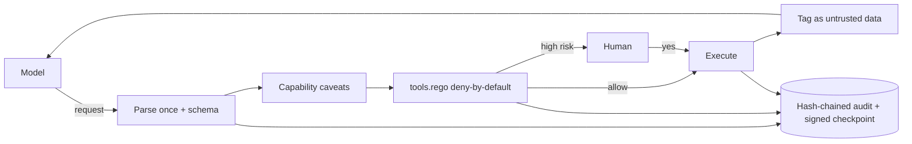

# A tool platform for AI agents with least privilege and an audit trail

## Why combine these

An agent with tools is a program whose control flow is partly written by text it reads. The AI-agents topic taught
the loop, MCP tool servers and why prompt injection works; cryptography taught signatures, MACs and tokens;
application architecture taught ports and adapters, policy as code and fitness functions. Each alone fails here.
A careful prompt cannot stop a model that obeys a poisoned document. A signed token means nothing if the host
checks it against the wrong argument. A policy engine is only as honest as the facts it is given. Together they
give a host where the model can **request** any call but only code can **authorise** one, and where every decision
can be proved afterwards.

## Architecture walkthrough

The host is a hexagon. Driven ports: the model (shared fake over HTTP or a scripted model; Ollama later), the
policy decision point (the L400 #19 `rego_lite` engine reading `policy/tools.rego`), the approver and the audit log.
At start the loader verifies each tool's Ed25519-signed manifest and the SHA-256 of the implementation file it is
about to import. A session gets a macaroon: an HMAC chain over caveats such as `tool in search_docs,read_file,
save_memory`, `expires < now+60` and `arg read_file.path prefix docs/`. For every proposed call the host parses the
arguments once, validates them against the signed schema, verifies the token against those same parsed
arguments, checks that side-effect targets came from the user's own words, and builds the policy input itself.
Allowed high-risk calls wait for a human who sees the exact call. Results go back wrapped in `<untrusted_data>`.
Every step is a header in a SHA-256 hash chain whose head is signed at the end of the session.

## The seams

**Model output → policy engine.** The contract is "a tool name and a JSON string, nothing more". Fields such as
`approved: true` or `capability: admin` fail the schema (`additionalProperties: false`) and never reach the PDP
as facts; denied calls never reach the human, so an attacker cannot cause approval fatigue.

**Tool manifest → loader.** The policy trusts `sideEffect`, `risk`, `x-provenance` and `x-sensitive`. Flip one
after review and the policy is bypassed silently, so the signature covers the canonical manifest and the manifest
pins the code digest. Over MCP, `tools/list` must equal the signed definitions; a poisoned description is refused.

**Token scope → argument validation.** A caveat is checked against a string. If the tool resolves
`docs/../secrets/api_key.txt` while the check compares raw strings, the prefix test passes and the secret is read.
The fix is to check the normalised value, require a single email address, and run the check after schema validation.

**Audit log → retention and privacy.** The log must prove what happened without storing what must not be kept.
Headers pin a body hash; bodies are redacted (tokens as id + fingerprint, sensitive fields as hash + length,
secret patterns scrubbed) and can be erased by retention while the chain still verifies.

**Tool output → model context.** Escaping stops a payload from closing the tag and posing as the system, but the
model in S2 still requested `send_email`. Tagging is labelling; enforcement is the policy.

## Worked run

`python run_project.py` printed 13 PASS lines. In S2 the poisoned doc made the fake model request
`send_email` to `attacker@evil.test`; the decision logged `deny: ["no valid capability for this call",
"side-effect target not from the user's request"]` and the world recorded 0 effects, while the naive host sent the
email. Across the 40-item seeded corpus (phrasings from ai-agents L300 #16) the model obeyed 24 payloads; the
secure host executed 0 and ran 0 side effects without scope, the naive host executed 24 with 16 side effects.
The S2 log had 5 entries; all 31 seeded edits (field edits, deletions, swaps, truncation, a rebuilt chain) were
detected, but only 20 of 31 when entries were checked alone. Fifty tokens with seeded TTLs from 1 to 300 s were
valid at TTL−1 and rejected at TTL on the fake clock, even after an attempt to append a later expiry. Each
`--inject` fault fails the matching scorecard line and exits 1.

## Failure modes at scale

**Provenance by substring stops fitting.** Real tasks paraphrase ("email the team"); denials rise. The signal is a
growing share of "target not from the user's request" decisions on benign sessions; the answer is structured intents
or a confirmation step, not a looser match.

**One symmetric root key.** Once tools run in other services, each verifier needs the key. Watch for the key being
copied into a second deployment; switch to public-key tokens or a token-exchange service.

**Linear audit verification.** Verifying a chain of millions of entries per audit takes minutes and checkpoints are
only as safe as their storage. The signal is audit jobs timing out; move to a Merkle log with an external witness.

## Common mistakes

1. **Trusting tool metadata from the server.** Annotations like "read-only" must come from a signed manifest you
   reviewed, not from `tools/list` at runtime.
2. **Checking scope on a different value than you execute.** Parse once, validate, normalise, then check and run
   that same object; never re-parse the model's JSON in the tool.
3. **Logging the token or the payload "for debugging".** A bearer token in a log is a credential leak; log its id
   and a fingerprint, and hash sensitive fields.
