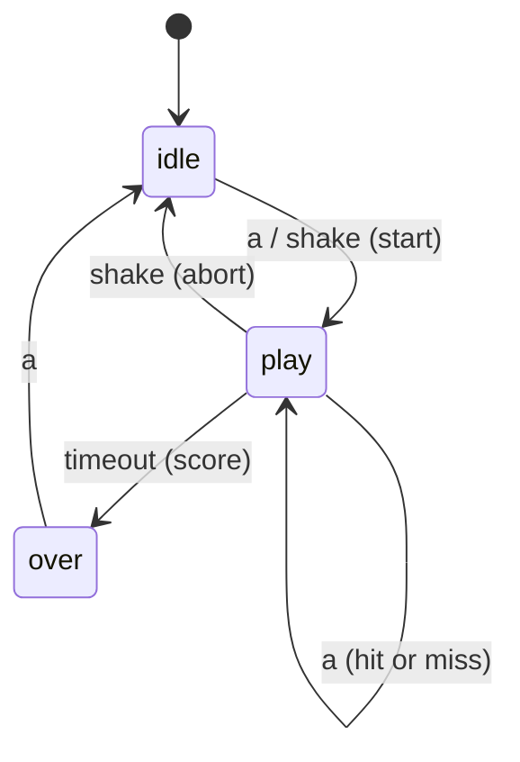

# A game as a state machine — explained

## The intuition
A game loop full of nested `if`s ("if playing and A pressed and not over and…") becomes unreadable fast. A **state machine** splits the problem in two: *what happened* (events: `a`, `shake`, `timeout`) and *what it means right now* (a table keyed by `(state, event)`). The whole behaviour of "catch the dot" fits in six rows of `TRANSITIONS`; any pair not in the table is ignored.

The subtle move is that **time is an event too**. The loop never sleeps to measure a round. It reads `running_time()` once per pass, and when `now - started >= ROUND_MS` it emits `timeout` like a button press. The dot's position is also derived from elapsed time, `((now - started) // STEP_MS) % 5`, so drawing and scoring agree.

**Analogy:** a reducer in a front-end store — `(state, action) → new state` — with side effects run by the caller. Where the analogy breaks: here the "store" is polled every 20 ms and the clock itself injects actions.



The one thing to remember: behaviour lives in the table; events — including time — just look rows up.

## Walkthrough: what actually happens when you run it
1. **You run** a peek: click A at t = 0 and step.
   **What happens inside** `events()` returns `["a"]`; `next_state("idle","a")` gives `("play","start")`; `handle()` stores `started = 0` and prints the change.
   **What you see**
   ```
   idle -> play (a)
   ```

2. **You run** A at t = 600 ms and again at t = 900 ms.
   **What happens inside** `("play","a")` maps to `("play","hit")`, so the state does not change; `dot_x` decides the score: 600 // 300 = 2 (the target column), 900 // 300 = 3.
   **What you see**
   ```
   t=600 dot_x=2
   hit 1
   t=900 dot_x=3
   miss 1
   ```
   **What it means** Same event, same row, different outcome — because the action reads the clock.

3. **You run** the clock to 5999 ms, step, then 6000 ms, step.
   **What you see**
   ```
   t=5999 state=play
   play -> over (timeout)
   score 1
   t=6000 state=over
   ignored pair: ('over', None)
   ```
   **What it means** `>=` ends the round exactly at 6000, not a millisecond early (a test checks this). A shake in `over` has no row, so `next_state` returns the same state and no action.

4. **You run** `python3 try_it.py`.
   **What you see**
   ```
   try 1: idle -> play (a)
   try 2: idle -> play (a) | miss 0
   ```
   **What it means** Deleting one row removes a whole behaviour (shake-abort) with no other code change. With `STEP_MS = 150`, at 600 ms the dot is at column (600 // 150) % 5 = 4, so the same press misses.

5. **You run** the tests and the build-task check.
   **What you see**
   ```
   Ran 9 tests in 3.421s
   Ran 2 tests in 0.009s
   ```
   **What it means** The test suite walks every `(state, event)` pair. The build task adds `paused` with two rows and shifts `started` forward by the paused time so it does not count.

Expected (not run here): the stub's clock moves only with `sleep()`, so timings here are exact; in the simulator real time passes, so the harness checks transitions only.

## Common confusions
**Q:** A missing table entry is a bug. — **A:** It is the "ignore" rule: `ignored pair: ('over', None)`.

**Q:** Use `sleep(6000)` for the round. — **A:** The loop would stop polling buttons; time is checked, not waited for.

**Q:** `hit` changes state. — **A:** It is a self-transition: `play → play` with an action.

## Check your understanding
1. Where is the dot at t = 1500 ms with `STEP_MS = 300`?
<details><summary>Answer</summary>(1500 // 300) % 5 = 0, the left column.</details>

2. Why is `timeout` only generated in `play`?
<details><summary>Answer</summary>Elapsed time since `started` only means "round over" while a round runs.</details>

3. How does pause avoid counting paused time?
<details><summary>Answer</summary>On resume it adds the paused duration to `started`.</details>
