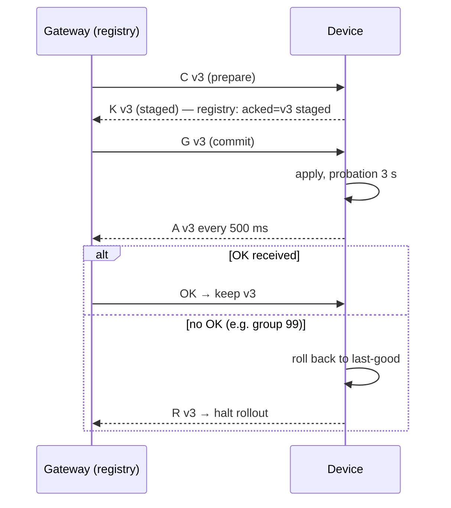

# Device fleet management: versioned config over the radio — explained

## The intuition
Pushing config over a lossy radio fails two ways. **You don't know what is running**: a device applies v2, its reply is lost, and the dashboard describes a fleet that does not exist. **A bad config locks you out**: v3 sets the radio group to 99 and the device can no longer hear the gateway — including the fix.

The design answers each with a classic mechanism:
- **Two-phase update.** The gateway sends `C` (prepare); the device *stages* the config and replies `K`. Only after holding `K` does the gateway send `G` (commit); the device applies it and reports `A`. The gateway's **registry** of acknowledged versions changes only on `K`/`A`, so it is the source of truth.
- **Probation with automatic rollback.** After applying, the device repeats `A` every 500 ms for 3 s. If no `OK` comes back, it assumes the new config broke the link, rolls back to last-good, and reports `R`. A board in group 99 never hears `OK` — so it rescues itself.
- **Staged rollout.** Canary 1 → then 2 → then 3. Any `R`, `N` or wave timeout halts the job, so a bad version reaches at most one device.

**Analogy:** a Kubernetes rolling deployment with readiness probes and auto-rollback. Where the analogy breaks: the "probe" runs on the device, because a broken device cannot be reached — it must notice its own isolation.



The one thing to remember: never let a device run what the registry has not acknowledged, and let the device undo a config that cuts it off.

## Walkthrough: what actually happens when you run it

### The decision: three options, measured
1. **You run** `python3 fleet_sim.py` (seed 18, 10 % loss per link; v2 is good, v3 at 15 s sets group 99).
   **What you see**
   ```
   {"device": "config_agent.py", "strategy": "push-all", "unacked_ticks": 12086, "max_on_bad": 5, "deaf_device_ms": 120800, "jobs": "v2 done @310, v3 halted @23010", "final": "333332", "gw_sent": 177}
   {"device": "solution.py", "strategy": "push-all", "unacked_ticks": 0, "max_on_bad": 4, "deaf_device_ms": 12000, "jobs": "v2 done @1210, v3 halted @18310", "final": "222222", "gw_sent": 99}
   {"device": "solution.py", "strategy": "staged", "unacked_ticks": 0, "max_on_bad": 1, "deaf_device_ms": 3000, "jobs": "v2 done @1850, v3 halted @18610", "final": "222222", "gw_sent": 34}
   ```
   **What it means**
   - **A, one-phase push-all:** fastest (v2 done at 310 ms) but 12,086 device-ticks on unacknowledged versions, and `final 333332`: five devices stuck on v3 in group 99, deaf for 120,800 device-ms and counting.
   - **B, two-phase push-all:** the invariant holds (0 unacked) and every device rolled back (`222222`), but 4 devices were deaf at once for a total of 12,000 device-ms — fails "at most 1 exposed".
   - **C, two-phase staged:** 1 device exposed, 3,000 device-ms deaf, halted after the canary; 640 ms slower (1,850 vs 1,210) but 34 frames instead of 99.

### Failure lab: inject → symptom → diagnose → fix → proof
2. **Inject / symptom.** Option A's row above; `test_fault` pins it (`Ran 1 test … OK`).
3. **Diagnose.** `config_agent.py` applies on receipt and sends `A` once; nothing undoes group 99.
4. **Fix.** `solution.py`: stage on `C`, apply on `G`, repeat `A` in a probation watchdog, roll back without `OK`. `fleet.py` provides staged waves.
5. **Proof.** **You run** the build task before and after.
   **What you see**
   ```
   AssertionError: Lists differ: [3, 3, 3, 3, 3, 2] != [2, 2, 2, 2, 2, 2]
   AssertionError: 12086 != 0 : push-all
   FAILED (failures=2)
   Ran 2 tests in 1.985s
   ```
   **What it means** The before-version leaves five devices on v3 and breaks the invariant; the solution passes both tests.

### Why the ADR chose C, and how it stays true
6. ADR 0018 accepts two-phase + 3 s probation + canary waves. Consequences it names: slower rollouts, more device state, last-good kept in RAM here (a board should persist it to flash), and config frames still unauthenticated (fixed by ADR 0019).
7. **You run** `python3 -m unittest test_fitness`.
   **What you see**
   ```
   Ran 1 test in 50.202s
   ```
   **What it means** 20 runs — 5 seeds × 10 %/30 % loss × push-all/staged — all with `unacked_ticks == 0`, and staged `max_on_bad <= 1`.

8. **You run** `python3 try_it.py`.
   **What you see**
   ```
   try 1: jobs: v2 halted @3310, v3 halted @18310 | final versions 111111 | unacked_ticks 0
   try 2: jobs: v2 halted @8920, v3 halted @16810 | final versions 111111 | unacked_ticks 0
   ```
   **What it means** Sending `A` only once, or a 300 ms probation on a 30 % loss link, turns ordinary packet loss into *false rollbacks*: even the good v2 is halted and the fleet stays on v1. Safe (invariant intact) but useless — probation must be long enough for several reports to get through.

Expected (not run here): a simulator run answering injected C/G frames is pending CI.

## Common confusions
**Q:** Two-phase alone limits the damage. — **A:** Option B: `max_on_bad 4`. Only staging limits blast radius.

**Q:** Rollback needs the gateway. — **A:** A deaf device cannot hear it; *missing* `OK` triggers rollback.

**Q:** Shorter probation = faster recovery = better. — **A:** Try 2: false rollbacks of a good config.

## Check your understanding
1. Why must the gateway wait for `K` before sending `G`?
<details><summary>Answer</summary>So no device can apply a version the registry has not recorded as staged.</details>

2. Where do the 3,000 deaf device-ms in option C come from?
<details><summary>Answer</summary>One canary on v3 for the 3 s probation before rolling back.</details>

3. What breaks if last-good lives only in RAM?
<details><summary>Answer</summary>A reset reverts to the factory config instead of the last acknowledged one.</details>
