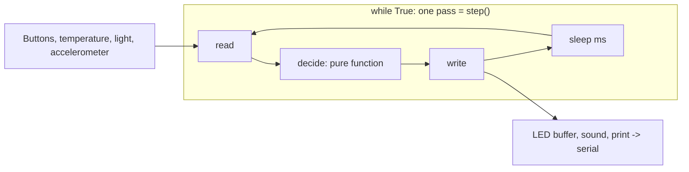

# micro:bit concepts primer

Read this once before the lessons: what the domain is for, one picture of how it fits together, and the words you will meet.

## What it is for in practice

The BBC micro:bit is a small single-board computer: a processor with sensors, 25 LEDs and buttons wired to it ([hardware overview](https://tech.microbit.org/hardware/)). It is used for teaching physical computing with the [micro:bit Python Editor](https://github.com/microbit-foundation/python-editor-v3) (MIT), simple sensor logging, interactive devices, and prototyping firmware ideas in MicroPython, which also runs on other boards ([MicroPython docs](https://docs.micropython.org/en/latest/library/machine.Pin.html)). The [V2 simulator](https://github.com/microbit-foundation/micropython-microbit-v2-simulator) (MIT) runs the real firmware as WebAssembly, so no board is needed.

## One mental model: sense → decide → act, forever

Almost every micro:bit program is a **control loop**: read inputs, decide, write outputs, sleep. If the loop is busy (a long `scroll`, a blocking `music.play`), inputs wait.

In this KB the loop body is always a `step()` function, so it runs on the simulator, on a board, or once inside a unit test with a stub.

## Concept map by level

L100–L400, the capstone and the L500 theory companion are built:

| Level | Core concept | One line | Local agent (proposal; code decides) |
|---|---|---|---|
| L100 | Run it | One board, polling loop: display, buttons, sound, temperature/light, motion; simulator + stub tests. | Explains serial telemetry (lab 05). |
| L200 | Build it | Radio between two boards, data logging + CSV export, pins/PWM, I²C sensor (simulated), game state machine. | Explains a logged CSV; code computes stats, checks quoted numbers (lab 08). |
| L300 | Harden it | Reliable radio (ARQ, CRC), non-blocking scheduler, power budget model, serial gateway, an interrupt race in Rust (Renode sibling). | Explains gateway counters; code raises alarms, checks its numbers (lab 15). |
| L400 | Design it | Edge-to-cloud path, fleet config, radio MAC + replay window, digital twin, capstone. | Explains incidents from a frozen record; cannot change alarms (lab 21). |
| L500 | Theory & rigour | Proofs + code checks: two's complement, Ohm/power, quantisation, PWM; sampling theorem, filters; PID stability, RM bound, CRC over GF(2); ethics of classroom data; Shannon 1949 and Liu & Layland 1973. | Proposal: a model may explain a derivation step; `research/l500_checks.py` recomputes every number, so no model output is trusted. |

## Glossary

| Term | Meaning |
|---|---|
| MicroPython | Python 3 for microcontrollers; the micro:bit build adds the `microbit` module. |
| Flash | Copy a program to the board (or simulator) and restart it. |
| Simulator | Browser micro:bit V2 running the real firmware as WebAssembly. |
| Serial / REPL | Text stream from `print()` to the computer / interactive `>>>` prompt on it. |
| Polling | Reading an input repeatedly inside a loop. |
| Edge vs level | "Went down since last check" vs "is down now". |
| Display buffer | In-memory 5×5 brightness grid that the driver shows. |
| milli-g | 1/1000 of standard gravity; accelerometer unit. |
| Threshold / hysteresis | Cut-off value / separate on and off cut-offs to stop flicker. |
| Stub | Fake module with the same API, used only in tests. |

## Common misconceptions

1. **"It worked in the simulator, so it works on my board."** The simulator shows a V2; V2-only code fails on a V1, and sliders are not real physics ([editor FAQ](https://microbit.org/new-microbit-python-editor/)).
2. **"`temperature()` is the room temperature."** The sensor is inside the processor and gives an approximation ([sensors page](https://microbit.org/get-started/features/sensors/)).
3. **"`is_pressed()` in a loop catches every press."** Only if the loop polls while the button is held; `was_pressed()`/`get_presses()` remember presses between polls ([buttons docs](https://microbit-micropython.readthedocs.io/en/v2-docs/button.html)).

Next: read `content/concepts/01-setup.md`, then do the lab and its `tryIt` items.
