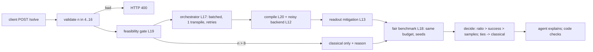

# Capstone: an end-to-end quantum optimisation service — explained

## The intuition

The capstone wires lessons 12–21 into one service. A client posts a MaxCut instance and gets the best cut plus an honest verdict on whether the quantum solver helped. Each lesson is a stage: feasibility gate (19), orchestrator (17), error-aware compiler on a drifted 8-qubit ladder (20), noise model (12), readout mitigation (13), fair harness against greedy and annealing (18). Code picks the winner; a local model may only *explain* it, and its text is checked.

**Analogy:** a CI pipeline for a decision: each stage has a contract test, and the final verdict is computed, not written.
Where the analogy breaks: the "build" here is stochastic, so every contract is a statistical bound with seeds, not an exact equality.



The one thing to remember: the service is trustworthy because each stage's promise is a test, and the winner is computed by code from a fair benchmark.

## Walkthrough: what actually happens when you run it

1. **You run** `python run_capstone.py`.
   **What happens inside:** `collect()` starts the service on 127.0.0.1, calls `/health`, a default `/solve`, a bad (`n = 30`) and a large (`n = 12`) request, re-runs without faults, checks the noise model and the agent; `milestones()` turns each measurement into pass/fail.
   **What you see:**
   ```text
   {"milestone": "M1 API and validation", "pass": true, "measure": {"health": 200, "solve": 200, "bad_request": 400, "bad_reason": "n must be an integer in [4, 16]"}}
   {"milestone": "M2 orchestrated quantum path (batched, cached, retried)", "pass": true, "measure": {"jobs": 10, "retries": 2, "transpiles": 1, "wall_s": 28.8, "mode": "batched"}}
   {"milestone": "M3 compile + noise model", "pass": true, "measure": {"esp": 0.5072, "cx": 52, "depth": 42, "gate_fidelity": 0.6224, "tvd_model": 0.0213, "tvd_ideal": 0.073}}
   {"milestone": "M4 readout mitigation", "pass": true, "measure": {"ideal": 7.3525, "gate_noise_only": 6.8418, "raw": 6.774, "mitigated": 6.8549, "calibration_shots": 32000}}
   {"milestone": "M5 fair benchmark + code decides", "pass": true, "measure": {"winner": "annealing", "n12_winner": "annealing", "n12_reason": "needs 12 qubits > 8 on the device"}}
   …
   {"scorecard": "6/6 milestones, 6/6 rubric", "winner": "annealing", "decided_by": "code"}
   ```
   **What it means:** M2: two seeded job failures were retried and the results equal a fault-free run. M3: the simple noise model is close to the density matrix (TVD 0.0213) and clearly better than assuming no noise (0.073). M4: mitigation moves ⟨C⟩ from 6.774 to 6.8549, closer to the gate-noise-only value 6.8418 than raw; it cannot recover the ideal 7.3525, because readout correction does not undo gate noise.

2. **You run** `python pipeline.py` (one request's report).
   **What you see:**
   ```text
   "optimum": 10,
   …
   "solver": "qaoa-noisy", "budget": 2000, "runs": 5, "median_ratio": 1.0, "success": 1.0, "median_first_best": 1013,
   …
   "winner": "annealing",
   ```
   **What it means:** all three solvers find the optimum, so the tie-break decides: annealing reached it in 13 samples, greedy 32, QAOA 1013.

## Walkthrough: the decisions

- **ADR 0001 (execution):** batched orchestrator with structural cache, kept true by `test_execution_budget` (wall ≤ 60 s, 1 transpile). Measured: 28.8 s, 1 transpile.
- **ADR 0002 (code decides):** fair harness plus `decide()`; ties go classical. `test_code_decides_and_ties_go_classical` recomputes the winner. The agent's "pitch" claiming a QAOA win and "99.9" was rejected.
- **ADR 0003 (readout mitigation only, no ZNE):** M4 shows readout correction helps; ZNE would multiply circuit runs on an already deep circuit (52 CX). Guarded by `test_mitigation_helps`.
- **ADR 0004 (feasibility first):** `n = 12` never reaches the 8-qubit device; `test_feasibility_gate`.

`python try_it.py` probes the decisions:
```text
small_budget      ('annealing', {'greedy': 1.0, 'annealing': 1.0, 'qaoa-noisy': 1.0})
calibrated_device {'esp': 0.5103, 'gate_fidelity': 0.6262, 'cx': 47, 'depth': 48}
```
A smaller budget changes nothing, and removing the drift barely helps because layout already routes around it.

## Common confusions

- **Q:** QAOA succeeded (1.0), so it should win. — **A:** Everyone succeeded; samples to best (1013 vs 13) decide.
- **Q:** Mitigation should reach the ideal 7.3525. — **A:** Readout correction only targets readout error (6.8418 reference).
- **Q:** The agent picks the answer. — **A:** It explains; "pitch" was REJECT because it contradicted code.

## Check your understanding

1. Why does `n = 12` still get an answer?
<details><summary>Answer</summary>The gate refuses only the quantum path; classical solvers answer and the report states why.</details>

2. What proves retries are safe here?
<details><summary>Answer</summary>M2 compares the faulty run's benchmark rows with a fault-free run: identical.</details>

3. Which test fails if someone hard-codes `winner = "qaoa-noisy"`?
<details><summary>Answer</summary>`test_code_decides_and_ties_go_classical`.</details>
