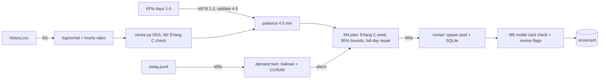

# Capstone: a digital twin of a service centre — explained

## The intuition

One decision: how many call-centre agents per hour tomorrow, and what to do when today's demand surprises you? Each milestone reuses a lesson: input modelling (7), a verified DES (8), calibration with a holdout (13), bounded staffing (10, 18), a checkpointed runner (20), the lesson 17 CUSUM, a checked model card (21).

The SLA — ≥ 80% answered within 1 minute, ≤ 5% abandoned, in *every* hour — is beyond Erlang C: handle times are lognormal and callers hang up.

Analogy: a release pipeline whose stages must all go green.
Where the analogy breaks: a green stage can still ship a *flagged* decision for human sign-off.



The one thing to remember: the formula seeds the plan, the simulation with bounds decides it, and governance code — not prose — gates what gets published.

## Walkthrough: what actually happens when you run it

1. **You run** `python run_capstone.py` (463 s here on one shared CPU; the lesson says about 3 minutes).
   **What happens inside:** M1–M6 run in order on seeded data; each prints one JSON line.
   **What you see:**
   ```
   {"milestone": "M2 DES core verified", "pass": true, "sl_sim": 0.8376, "sl_erlang_c": 0.8365, "reproducible": true}
   {"milestone": "M3 calibration + holdout validation", "pass": true, "patience_min": 4.5, "patience_plausible": [3.0, 5.5], "sl_mae_pp": 1.09, "abandon_mae_pp": 0.73}
   ```
   **What it means:** M2 is a degenerate case where the DES must match Erlang C. M3 reports a *plausible set* 3.0–5.5 for patience (hidden truth 3.0): weak identifiability, stated honestly.

2. **You run** the same command; read M4–M6.
   **What you see:**
   ```
   {"milestone": "M4 sensitivity + staffing under SLA", "pass": true, …, "agent_hours": 221, "erlang_c_hours": 219, "flat_hours": 300, …, "day_sl_min_low": 0.872, "day_abandon_max": 0.036}
   {"milestone": "M5 parallel replications + live twin", "pass": true, "resume_identical": true, "alarm_delay_min": 75, "m_at_alarm": 1.201, "replan_from": "15:00", "extra_agent_hours": 14, "static_sl_after": 0.719, "twin_sl_after": 0.896}
   {"milestone": "M6 governance pack + agent explanation", "pass": true, "card_findings": [], "review_flags": ["hour 15:00 plans for 6.16 calls/min > validated 5.6"], "agent_unverified": ["9"], "agent_publish": false, …}
   {"scorecard": "PASS", "passed": 6, "total": 6}
   ```
   **What it means:** the twin catches the 13:00 surge 75 min later; re-planning from 15:00 lifts the worst service level from 0.719 to 0.896. 6.16 calls/min is outside the validated 5.6: review flag. The agent's unverified "9" blocks its text.

## The decision

3. **You run** `python try_it.py`.
   **What you see:**
   ```
   point estimates : 208 agent-hours, worst-hour mean abandonment 0.064
   95% bounds      : 221 agent-hours, worst-hour mean abandonment 0.036
   Erlang C only   : 219 agent-hours, worst-hour mean abandonment 0.036
   ```
   **What it means:** deciding on point estimates saves 13 agent-hours and breaks the 5% abandonment limit. Erlang C looks almost as good on means, but ADR 0001 records that 2 of its hours fail the 95% bound — and it cannot model abandonment at all, so it cannot re-plan a surge.

ADRs: **0001** Erlang C seed, simulation with 95% bounds, full-day repair (+2 agent-hours buys stated confidence). **0002** re-plan on CUSUM alarm, not hourly (that chases noise). **0003** lesson-20 runner; publish only with no card findings. `test_fitness.py` pins each: SLA holds, alarm within 90 min, card current. **You run** `python -m unittest test_fitness -v` → **What you see:** `Ran 3 tests in 89.819s` … `OK`.

## Common confusions

**Q:** 221 > 219, so Erlang C is cheaper and good enough. — **A:** It ignores abandonment; 2 hours fail the bound.

**Q:** A review flag means the plan failed. — **A:** M6 passes; the flag routes 6.16 calls/min to a human.

**Q:** Patience is 4.5 min. — **A:** The plausible set is 3.0–5.5.

## Check your understanding

1. Why does M2 switch off abandonment and use exponential service?
<details><summary>Answer</summary>To make Erlang C exact, so the DES can be verified against it.</details>

2. Why re-plan from 15:00 when the alarm fired at 14:15?
<details><summary>Answer</summary>Staffing changes on the next full hour; detection delay plus the hour boundary leaves 13:00–15:00 understaffed.</details>

3. Why is `agent_publish` false although the plan is decided?
<details><summary>Answer</summary>The explanation quoted a number ("9") not in the facts table; code refuses to publish unverified text.</details>
